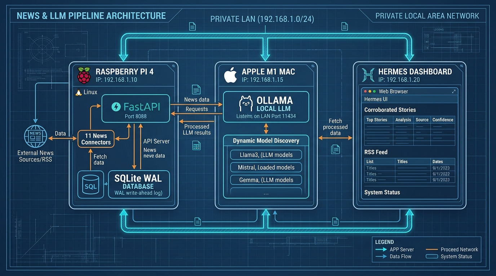
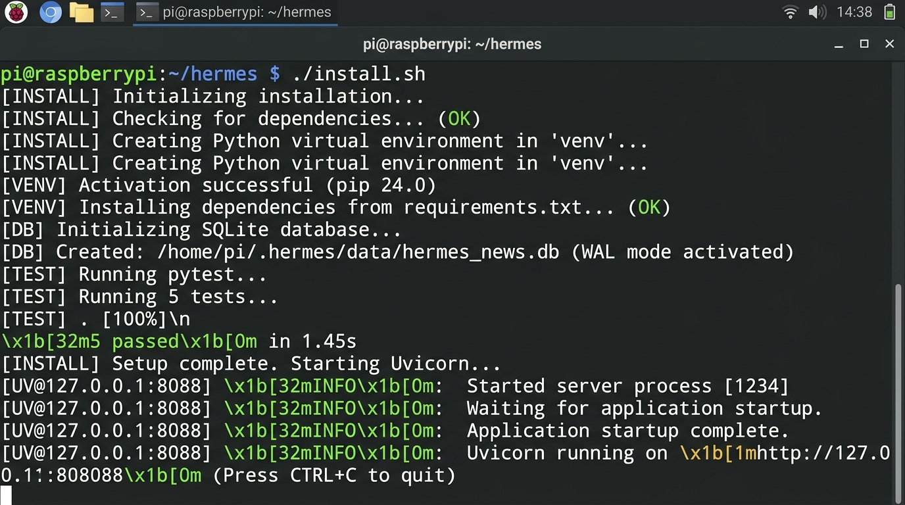

# Hermes Personal Free Global News Intelligence System

A private, zero-cost global news aggregation and local AI intelligence service designed for **Raspberry Pi** (collector, FastAPI service, and SQLite WAL database) paired over your private home LAN with an **Apple M1 Mac** running **Ollama** for local inference, integrated into your **Hermes Dashboard**.



---

## 1. System Architecture & Port Separation

| Component | Device | Default Binding | Purpose |
| :--- | :--- | :--- | :--- |
| **Hermes News FastAPI Service** | Raspberry Pi | `127.0.0.1:8088` (or Pi LAN IP `:8088`) | Runs APScheduler, 11 news connectors, scoring engine, JSON & RSS API |
| **SQLite WAL Database** | Raspberry Pi | `/home/pi/.hermes/data/hermes_news.db` | Persistent indexed storage with `UNIQUE(url)` & fingerprint deduplication |
| **Apple M1 Ollama Server** | Apple M1 Mac | `192.168.1.50:11434` (LAN only) | Local LLM inference with dynamic `/api/tags` model discovery |
| **Existing Hermes Gateway / UI** | Raspberry Pi / LAN | Your existing gateway port (e.g. `3000`) | Queries `http://127.0.0.1:8088/api/*` without port conflicts |

> **Security Note**: Neither `HERMES_PORT` (`8088`) nor Ollama (`11434`) is ever exposed to the public internet (WAN). All traffic remains strictly on `localhost` or your private `192.168.x.x` LAN subnet.

---

## 2. Instruction for Hermes Agent to Install & Integrate Autonomously

If you want your **Hermes Agent** to install, test, and wire this service into your existing Hermes Gateway automatically, give Hermes Agent the following instruction block:

```text
Hermes Agent: Install and integrate the Global News Intelligence Service on this Raspberry Pi.

1. Preserve all existing Hermes Gateway and Dashboard files. Do not change the existing Hermes Gateway port.
2. Use SQLite WAL database path: /home/pi/.hermes/data/hermes_news.db
3. Bind the FastAPI news service locally to 127.0.0.1:8088 (HERMES_HOST=127.0.0.1, HERMES_PORT=8088).
4. Point OLLAMA_BASE_URL to the Apple M1 Mac on LAN (e.g. http://192.168.1.50:11434) and use dynamic /api/tags model discovery.
5. Run the automated installer and test suite:
   mkdir -p "$HOME/.hermes/data"
   cd raspberry_pi_service
   chmod +x scripts/install.sh scripts/start.sh
   HERMES_HOST="127.0.0.1" HERMES_PORT="8088" SQLITE_DB_PATH="$HOME/.hermes/data/hermes_news.db" ./scripts/install.sh
6. Enable and start the user systemd service:
   systemctl --user enable --now hermes-news-intelligence.service
7. Verify health at http://127.0.0.1:8088/api/health and proxy /api/articles, /api/clusters, /api/health, /api/collect, and /api/feed.rss into the existing Hermes Dashboard.
```

---

## 3. Step-by-Step Manual Installation Guide



### Step A: Configure Apple M1 Mac Ollama for LAN Access

By default, Ollama on macOS listens only on `127.0.0.1:11434`. Enable LAN listening on your M1 Mac's private IP (for example `192.168.1.50`):

```bash
# 1. Check your M1 Mac's LAN IP address
ipconfig getifaddr en0

# 2. Bind Ollama to your M1 Mac's LAN IP (or 0.0.0.0:11434 on private LAN)
launchctl setenv OLLAMA_HOST "192.168.1.50:11434"
```

Restart the Ollama application on your M1 Mac, then verify from your Raspberry Pi that dynamic model discovery responds:

```bash
curl -s http://192.168.1.50:11434/api/tags | python3 -m json.tool
```

*Note: You do not need to hardcode a model name in Hermes. The intelligence engine automatically queries `/api/ps` and `/api/tags` to discover whichever model is installed on your M1 Mac, and continues working offline if your Mac is asleep.*

---

### Step B: Install the FastAPI Service & SQLite Database on Raspberry Pi

Run the automated installation script on your Raspberry Pi:

```bash
cd raspberry_pi_service
chmod +x scripts/install.sh scripts/start.sh

# Optional: customize your M1 Mac LAN IP or SQLite path before installing
export OLLAMA_BASE_URL="http://192.168.1.50:11434"
export SQLITE_DB_PATH="${HOME}/.hermes/data/hermes_news.db"
export HERMES_HOST="127.0.0.1"
export HERMES_PORT="8088"

./scripts/install.sh
```

What `install.sh` performs automatically:
1. Installs `python3-venv`, `python3-pip`, and `sqlite3`.
2. Creates an isolated virtual environment at `raspberry_pi_service/.venv`.
3. Installs all required Python packages from `requirements.txt` (`fastapi`, `uvicorn`, `feedparser`, `httpx`, `beautifulsoup4`, `apscheduler`, `sqlalchemy`, `python-dateutil`, `pytest`).
4. Creates `~/.hermes/data/` and initializes the SQLite WAL database at `~/.hermes/data/hermes_news.db` with all B-Tree indexes.
5. Executes the automated `pytest` verification suite (`tests/test_news_service.py`).
6. Generates a systemd user service (`~/.config/systemd/user/hermes-news-intelligence.service`).

---

### Step C: Start & Enable the Service on Raspberry Pi

To start the service foreground or via `start.sh`:

```bash
./scripts/start.sh
```

Or enable it permanently in the background via `systemd`:

```bash
systemctl --user enable --now hermes-news-intelligence.service
systemctl --user status hermes-news-intelligence.service
```

---

## 3. Verifying the Installation

Once running, verify the endpoints from your Raspberry Pi terminal:

```bash
# 1. Check collector health, SQLite article count, and M1 Ollama discovery
curl -s http://127.0.0.1:8088/api/health | python3 -m json.tool

# 2. Fetch prioritized top headlines (JSON)
curl -s "http://127.0.0.1:8088/api/articles?category=top&limit=10" | python3 -m json.tool

# 3. Fetch corroborated developing story clusters (JSON)
curl -s http://127.0.0.1:8088/api/clusters | python3 -m json.tool

# 4. Fetch valid RSS 2.0 XML output feed
curl -s "http://127.0.0.1:8088/api/feed.rss?category=ai_tech"
```

---

## 4. 11 Independent News Connectors Included

1. **GDELT DOC 2.0 JSON API** (`gdelt_doc_2`) — Global event wire
2. **Google News RSS** (`google_news_rss`) — Top headlines
3. **BBC RSS** (`bbc_world_rss`) — Global & breaking news
4. **Al Jazeera RSS** (`aljazeera_rss`) — Global affairs
5. **NPR RSS** (`npr_news_rss`) — US & Texas coverage
6. **DW RSS** (`dw_world_rss`) — European & international markets
7. **TechCrunch RSS** (`techcrunch_rss`) — AI, startups & technology
8. **Ars Technica RSS** (`arstechnica_rss`) — Deep tech, silicon & software
9. **NDTV RSS** (`ndtv_top_rss`) — India & South Asia coverage
10. **Times of India RSS** (`times_of_india_rss`) — India & Bangladesh regional news
11. **NASA and UN News RSS** (`nasa_un_rss`) — Space, science & global institutions
